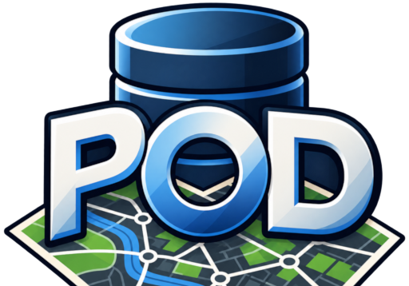

  
  <h1>PostOverpassDark</h1>
  
Consultas, visualización y análisis de datos OpenStreetMap.

  

    <a href="https://atarom.github.io/PostOverpassDark/">
      <strong>Abrir la aplicación ↗</strong>
    </a>
  

---

## Funciones

### Consultas

- Consultas mediante **Overpass QL** y **Postpass SQL/PostGIS**.
- Editor con resaltado de sintaxis, autocompletado, búsqueda y presets de ejemplo.
- Variables compatibles con consultas como `{{bbox}}`, `{{center}}` y `{{geocodeArea:...}}`.
- Inspección, copia y descarga de la consulta enviada, la respuesta original y el GeoJSON generado.

### Mapa

- Renderización WebGL de puntos, líneas y polígonos, con filtros dinámicos y mapa de calor configurable.
- Cartografía de referencia de ELI: fuentes TMS/WMS, búsqueda por zona, favoritos y ajustes de opacidad, brillo, contraste, saturación y fusión.
- Popups con etiquetas, relaciones y metadatos; navegación entre objetos superpuestos.
- Enlaces clicables en los valores de las etiquetas mediante **Tag2Link**.
- Medición de distancias y radios, selección espacial mediante polígonos y diagnóstico GPU/WebGL.

### Análisis y control de calidad

- Conteo de claves y valores de etiquetas, con separación por punto y coma o por palabras, colores configurables y filtros de coincidencia exacta o regex.
- Filtros numéricos por clave, histogramas, rangos mínimo/máximo y detección de valores atípicos.
- Análisis geométrico de longitud, superficie, perímetro, número de vértices y forma, con detección de anomalías.
- Análisis de aislamiento espacial basado en distancias a vecinos.
- Lista de resultados filtrados con ordenación y localización en el mapa; copia de valores y purga de elementos.

### Exportación y edición

- Acceso directo desde los popups a OpenStreetMap, iD, Rapid, Level0 y JOSM.
- Envío a JOSM mediante Remote Control, exportación de identificadores OSM y apertura de resultados en otra pestaña mediante IDsToPOD.
- Enlaces compartidos autocontenidos con compresión DEFLATE y Brotli 11, selección automática del formato más compacto y optimización de identificadores OSM mediante Delta/Varint.

## Tecnologías y datos

Aplicación web estática en JavaScript con módulos ES y Web Workers, sin proceso de compilación ni backend propio.

- [OpenLayers](https://openlayers.org/) — renderización WebGL, filtros dinámicos y navegación del mapa.
- [OpenStreetMap](https://www.openstreetmap.org/) — teselas del mapa base; [atribución y licencia de los datos](https://www.openstreetmap.org/copyright).
- [Editor Layer Index](https://github.com/osmlab/editor-layer-index) — catálogo de fuentes cartográficas de terceros.
- [Overpass API](https://overpass-api.de/) — consultas Overpass QL.
- [Postpass](https://postpass.geofabrik.de/) — consultas SQL/PostGIS.
- [CodeMirror](https://codemirror.net/) — editor de consultas.
- [osm2geojson-lite](https://github.com/tibetty/osm2geojson-lite) — conversión de respuestas OSM a GeoJSON.
- [Nominatim](https://nominatim.org/) — resolución de áreas para `{{geocodeArea:...}}`.
- [Tag2Link](https://github.com/JOSM/tag2link) — plantillas de enlaces para etiquetas OSM ([claves disponibles](https://taginfo.openstreetmap.org/projects/tag2link#tags)).
- [Brotli](https://github.com/google/brotli) — compresión de enlaces compartidos.
