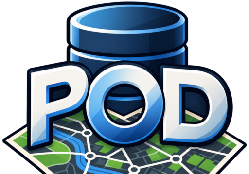

  
  <h1>PostOverpassDark</h1>
  

    <a href="https://atarom.github.io/PostOverpassDark/">
      <strong>Abrir la aplicación ↗</strong>
    </a>
  

---

## Funciones

- Consultas mediante **Overpass API** y **Postpass**.
- Editor con resaltado, autocompletado y presets de ejemplo.
- Variables compatibles con consultas como `{{bbox}}`, `{{center}}`, `{{geocodeArea:...}}`...
- Visualización normal o como mapa de calor.
- Conteo de keys y valores de los tags devueltos.
- Filtro por regex sobre la key seleccionada, con colores configurables.
- Filtro numérico por key con rango mínimo/máximo y visualización opcional de valores fuera de rango.
- Inspección de la consulta enviada, respuesta original y GeoJSON generado.
- Acceso directo desde los resultados a OpenStreetMap y distintos editores OSM.
- Envío directo a JOSM de objetos encontrados con Overpass o Postpass mediante Remote Control, sin XML intermedio ni backend Python.

## Enviar resultados Overpass o Postpass a JOSM

En JOSM activa **Preferencias → Control remoto → Habilitar control remoto**. Ejecuta una consulta Overpass con salida OSM XML o JSON, o una consulta Postpass que devuelva `osm_type`, `osm_id` y `geom`. El botón **Enviar a JOSM** recoge únicamente los IDs OSM originales devueltos en el resultado y permite que JOSM descargue los objetos actuales y miembros de las relaciones desde la API oficial de OpenStreetMap. No se genera XML intermedio ni se necesita Python en GitHub Pages. Las salidas tabulares o derivadas sin IDs originales no son enviables.

Se deduplican los identificadores en ambos modos, incluidas las representaciones geométricas múltiples de Postpass. No se impone un límite artificial de objetos; los envíos grandes se dividen automáticamente en solicitudes más pequeñas para respetar la longitud de las URL de JOSM. Consultas muy grandes pueden tardar o alcanzar límites de JOSM o de la API OSM. La primera crea una capa nueva en JOSM y las siguientes intentan añadir objetos a esa capa. Los datos proceden de OSM en su estado actual y pueden diferir de la actualización de Postpass. El navegador debe permitir solicitudes a `127.0.0.1:8111`, y JOSM debe estar abierto.

Para probar la aplicación localmente desde la carpeta del proyecto puedes ejecutar `python3 -m http.server 8000` y visitar `http://127.0.0.1:8000`.

## Tecnologías y datos

- [OpenLayers](https://openlayers.org/) — renderización WebGL, filtros dinámicos y navegación del mapa.
- [OpenStreetMap](https://www.openstreetmap.org/) — teselas del mapa base con estilo oscuro.
- [Overpass API](https://overpass-api.de/) — consultas Overpass QL sobre datos de OpenStreetMap.
- [Postpass](https://postpass.geofabrik.de/) — consultas SQL/PostGIS sobre datos de OpenStreetMap.
- [CodeMirror](https://codemirror.net/) — editor de consultas.
- [osmtogeojson](https://github.com/tyrasd/osmtogeojson) — conversión de respuestas OSM a GeoJSON.
- [Nominatim](https://nominatim.org/) — resolución de áreas para `{{geocodeArea:...}}`.
- [OpenStreetMap contributors](https://www.openstreetmap.org/copyright) — datos disponibles bajo licencia ODbL.
